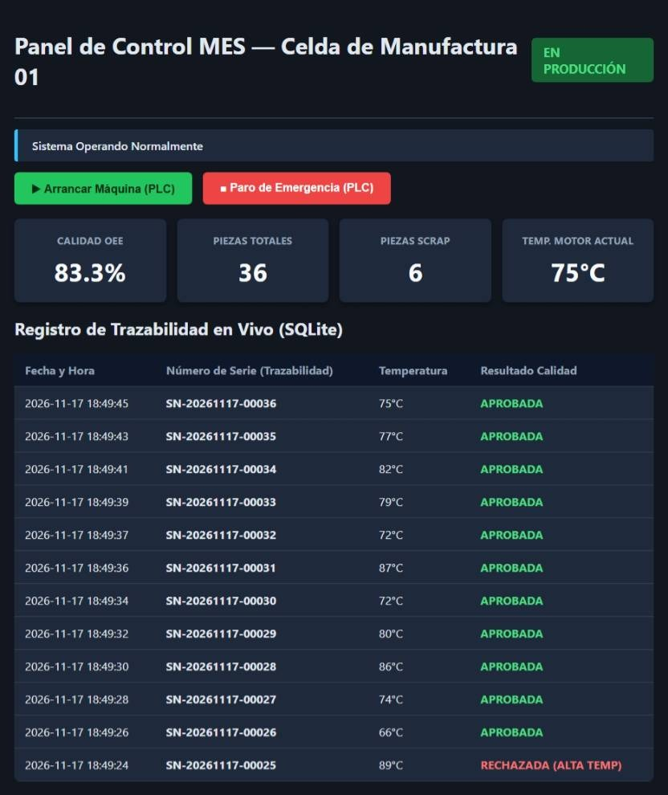

# MiniMES — Sistema de Ejecución de Manufactura y Monitoreo IIoT

Sistema **MES (Manufacturing Execution System)** ligero y multiplataforma diseñado para demostrar la integración real entre piso de producción (**OT - Operational Technology**) y sistemas empresariales (**IT - Information Technology**). 

El proyecto simula una celda de manufactura automatizada mediante un PLC virtual en **Python**, comunicándose de forma bidireccional vía protocolo industrial **Modbus TCP** con un motor backend en **C# (.NET)**, persistiendo trazabilidad pieza por pieza en **SQLite** y visualizando indicadores **OEE** en un dashboard web en tiempo real.



---

## Arquitectura del Sistema (Estándar ISA-95)

El flujo de datos e instrucciones replica la estructura de una planta de manufactura moderna:

1. **Nivel 2 — Control y Piso de Producción (`plc_simulador.py`):**
   * Servidor **Modbus TCP** desarrollado en Python (`pymodbus`) que emula el comportamiento de un PLC industrial.
   * Genera ciclos de producción, conteo de piezas, detección de scrap y telemetría de temperatura del motor.
   * Escucha registros de control externos para ejecutar paros o arranques de línea en tiempo real.

2. **Nivel 3 — Motor MES y Lógica de Negocio (`MotorMes`):**
   * Servicio en segundo plano (*Background Worker*) y **Minimal API** en **C# / .NET** utilizando `NModbus`.
   * Implementa detección por flanco de subida para evitar duplicidad de registros durante el *polling* cada 500 ms.
   * **Trazabilidad:** Asigna un número de serie único (`SN-YYYYMMDD-XXXXX`) a cada pieza fabricada y almacena su historial térmico y de calidad en **SQLite**.
   * **Pokayoke Activo (Control Bidireccional):** Si el sistema detecta **3 piezas consecutivas rechazadas** por sobrecalentamiento (>88°C), envía automáticamente una orden de escritura Modbus (`WriteSingleRegister`) para detener el PLC y proteger el equipo.

3. **Interfaz HMI / Dashboard Operativo (`wwwroot/index.html`):**
   * Panel web en tiempo real que muestra el estado de la máquina, métricas de **Calidad OEE**, piezas totales, scrap y temperatura actual.
   * Incluye controles remotos de **Arranque** y **Paro de Emergencia** conectados directamente a los registros del PLC.

---

## Mapa de Registros Modbus (Holding Registers)

| Dirección | Variable | Tipo / Acceso | Descripción |
| :--- | :--- | :--- | :--- |
| **40001 (0)** | `EstadoMaquina` | Lectura / Escritura | `0`: Detenida, `1`: En Producción, `2`: Alerta Alta Temp. |
| **40002 (1)** | `PiezasTotales` | Solo Lectura | Contador acumulado de piezas producidas en el turno. |
| **40003 (2)** | `PiezasScrap` | Solo Lectura | Contador acumulado de piezas rechazadas por calidad. |
| **40004 (3)** | `TemperaturaMotor` | Solo Lectura | Temperatura instantánea del motor en grados Celsius (°C). |

---

## Stack Tecnológico

* **Backend & Motor MES:** C#, .NET, ASP.NET Core Minimal API, `NModbus`
* **Simulador PLC (OT):** Python 3, `pymodbus` (v3.8.6)
* **Base de Datos:** SQLite (`Microsoft.Data.Sqlite`)
* **Frontend HMI:** HTML5, CSS3, JavaScript (Fetch API)

---

## Guía de Ejecución Local (Linux / Windows)

### 1. Clonar el repositorio
```bash
git clone https://github.com
cd MiniMES-Modbus-Monitor
```

### 2. Iniciar el Simulador de PLC (Terminal 1)
Se recomienda utilizar un entorno virtual de Python:
```bash
python3 -m venv venv
source venv/bin/activate  # En Windows: venv\Scripts\activate
pip install "pymodbus==3.8.6"
python3 plc_simulador.py
```

### 3. Iniciar el Motor MES y Dashboard (Terminal 2)
```bash
cd MotorMes
dotnet restore
dotnet run
```

### 4. Abrir el Panel HMI
Abre tu navegador web y accede a:
`http://localhost:5000`

---

## Autor

**Jose O. Corpus** — Ingeniero en Mecatrónica | Desarrollador Senior .NET / C# & Sistemas de Manufactura (MES / IIoT)  
* **LinkedIn:** [https://www.linkedin.com/in/josecoga](https://www.linkedin.com/in/josecoga)  
